

## Postdoctoral Scholars

| Name                                                                                                         | Period              | Additional Information                                                  |
| ------------------------------------------------------------------------------------------------------------ | ------------------- | ----------------------------------------------------------------------- |
| 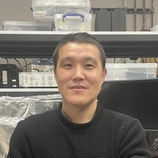Dr. Zhikun Zhang | Jan 2023 - Mar 2024 | Next: Associate Professor at Hebei University of Science and Technology |
| 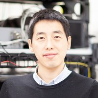Dr. Xiaodong He   | Feb 2019 – Jul 2020 | Next: Assistant Professor at Lanzhou University                         |
| 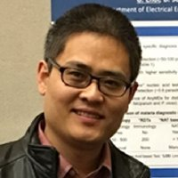Dr. Xiaonan Yang | Feb 2016 – Jan 2017 | Next: Associate Professor at Zhengzhou University                       |

---

## Ph.D. Students

| Name                                                                                                               | Graduated | Additional Information                                                                                                                                                                                                        |
| ------------------------------------------------------------------------------------------------------------------ | --------- | ----------------------------------------------------------------------------------------------------------------------------------------------------------------------------------------------------------------------------- |
| 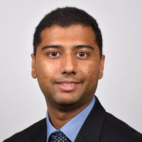Aneesh Kshirsagar | Oct 2025  | **Dissertation**: [Intelligent Point-of-Need Genomic Systems for Real-Time Pathogen Surveillance.](https://etda.libraries.psu.edu/catalog/22745alk5897)  **Next**: Postdoc, Indiana University Bloomington                 |
| 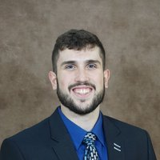Anthony Politza     | May 2025  | **Dissertation**: [Addressing Challenges in Sample Preparation and Nucleic Acid Testing for Personalized HIV Diagnostics.](https://etda.libraries.psu.edu/catalog/26983ajp6126)  **Next**: Airbus US Space & Defense, Inc. |
| 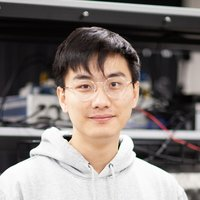Ming Dong                 | Dec 2024  | **Dissertation**: [Addressing Reliability Challenges in Solid-State Nanopore Sensors for Robust Point-Of-Care Diagnostics.](https://etda.libraries.psu.edu/catalog/20465mkd5669)  **Next**: Huawei Technologies            |
| 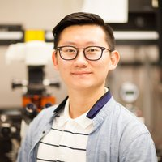Tianyi Liu               | Oct 2024  | **Dissertation**: [Advancing Integrated Nucleic Acid Testing for HIV Self-Testing and Personalized Viral Load Monitoring.](https://etda.libraries.psu.edu/catalog/21321tpl5215)  **Next**: Postdoc, Johns Hopkins          |
| 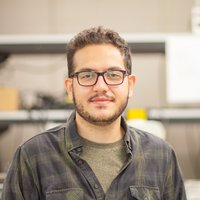Reza Nouri               | Aug 2022  | **Dissertation**: [Solid-state nanopore CRISPR-assisted diagnostic systems toward digital nucleic acid testing.](https://etda.libraries.psu.edu/catalog/21114rzn93)  **Next**: Nationwide Children’s Hospital              |
| 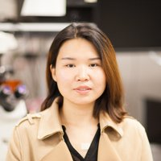Zifan Tang               | May 2022  | **Dissertation**: [Digital solid-state nanopore fabrication and sensing towards integrated nucleic acid testing.](https://etda.libraries.psu.edu/catalog/19328zxt34)  **Next**: Illumina Inc                               |
| 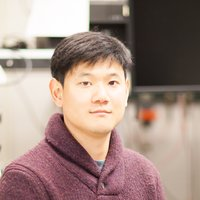Gihoon Choi             | May 2020  | **Dissertation**: [Microfluidic molecular and cellular detection of malaria towards elimination.](https://etda.libraries.psu.edu/catalog/17981gmc5400)  **Next**: Sandia National Laboratories                             |

---

## Master Students

| Name                                                                                                                             | Period              | Additional Information |
| -------------------------------------------------------------------------------------------------------------------------------- | ------------------- | ---------------------- |
| Ujwal Jibhkate                     | 2025                |                        |
| 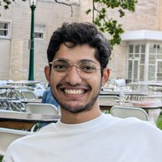Lakshmi Bhanu Aravind Nidamarty | 2025                |                        |
| 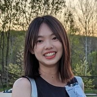Xue Xiao                                 | 2025                |                        |
| Aditya Bhausaheb Dhumal             | 2025                |                        |
| Yilin Zhang                           | Aug 2023 – Aug 2024 |                        |
| 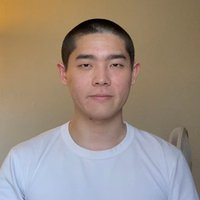Fanming Liu                           | Aug 2022 – Mar 2023 | **Next**: PhD, PSU     |
| Wenxin Cao                            | Aug 2020 – May 2021 |                        |
| Tianyi Liu                             | Aug 2019 – May 2020 | **Next**: PhD, PSU     |
| 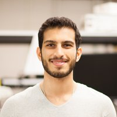Kamyar Roshan                       | Aug 2017 – May 2019 | **Next**: PhD, PSU     |
| Nicholas Budzinski                    | Aug 2017 – May 2018 |                        |
| Qi Yan                                | Aug 2016 – Dec 2017 |                        |

---

## Undergraduate Students

| Name                                                                                                               | Period              | Additional Information                                                                                                    |
| ------------------------------------------------------------------------------------------------------------------ | ------------------- | ------------------------------------------------------------------------------------------------------------------------- |
| Jack Wember             | 2025                |                                                                                                                           |
| Angelo Gonzalez     | 2025                |                                                                                                                           |
| Hueyue Pan              | Aug 2022 – Mar 2023 |                                                                                                                           |
| 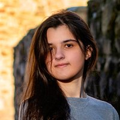Naqiyah Peatiwala | Jan 2022 – May 2022 |                                                                                                                           |
| 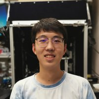Jiarui (Jerry) Cui       | Aug 2020 – May 2022 |                                                                                                                           |
| 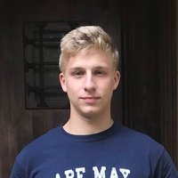Dean DeRosa             | Jan 2021 – May 2022 | Schreyer Scholar **Thesis:** Design and Validation of a Low-Cost 8-Channel qRT-LAMP Test with Real-Time Result Readout |
| 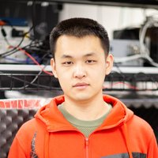Xiayu Wang               | Oct 2019 – Mar 2020 |                                                                                                                           |
| 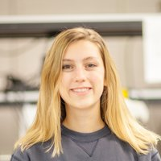Erica Murphy           | Aug 2018 – May 2019 | Schreyer Scholar **Thesis:** Microfluidic Time-Division Multiple Access Resistive Pulse Sensor For Particle Analysis   |
| Tianyi Liu               | Jan 2018 – May 2019 | CoE REU Program                                                                                                           |
| 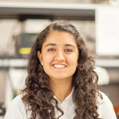Swasti Mehra           | Aug 2018 – Dec 2018 | CoE REU Program                                                                                                           |
| Fuchang Jiang           | Jan 2018 – May 2018 |                                                                                                                           |
| 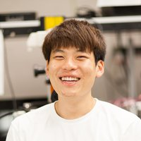Minkyu Lee               | Aug 2017 – May 2018 |                                                                                                                           |
| Rui Xia                 | Aug 2017 – Dec 2017 |                                                                                                                           |
| Shiming Fan             | Aug 2017 – Dec 2017 |                                                                                                                           |
| 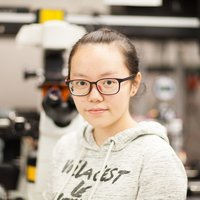Tong Hu                     | Aug 2017 – Dec 2017 |                                                                                                                           |
| 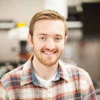Theodore Prince     | Feb 2016 – Dec 2017 | CoE REU Program                                                                                                           |
| Daniel Song             | Feb 2016 – May 2017 |                                                                                                                           |
| Jeffery Miller          | Aug 2015 – Dec 2015 |                                                                                                                           |
| John DiDonato           | Aug 2015 – Dec 2015 |                                                                                                                           |
| Kristina Ly             | Jan 2015 – Dec 2015 | CoE REU Program                                                                                                           |
| Parker Reusch           | Jan 2015 – May 2015 |                                                                                                                           |
